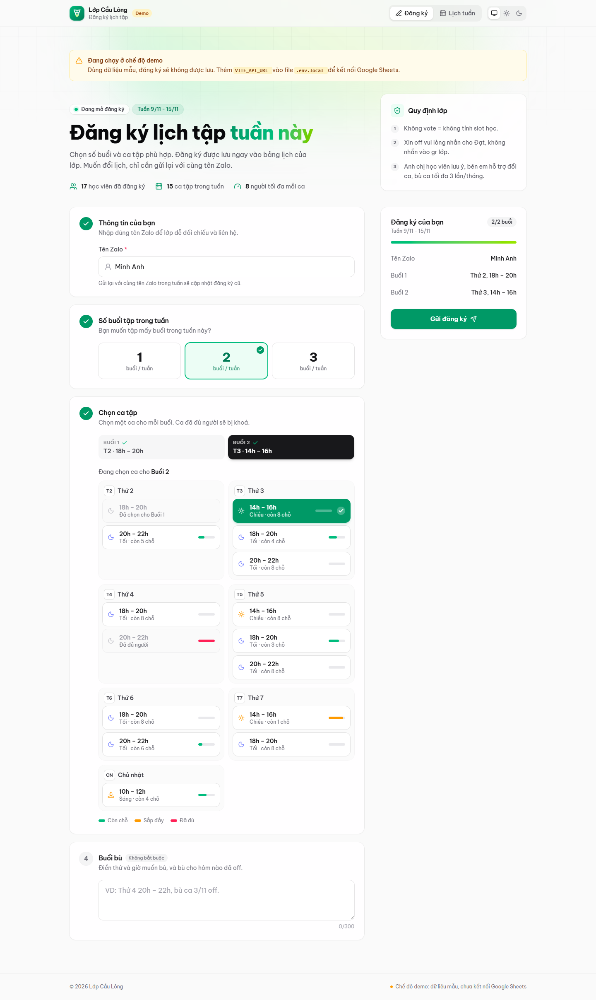
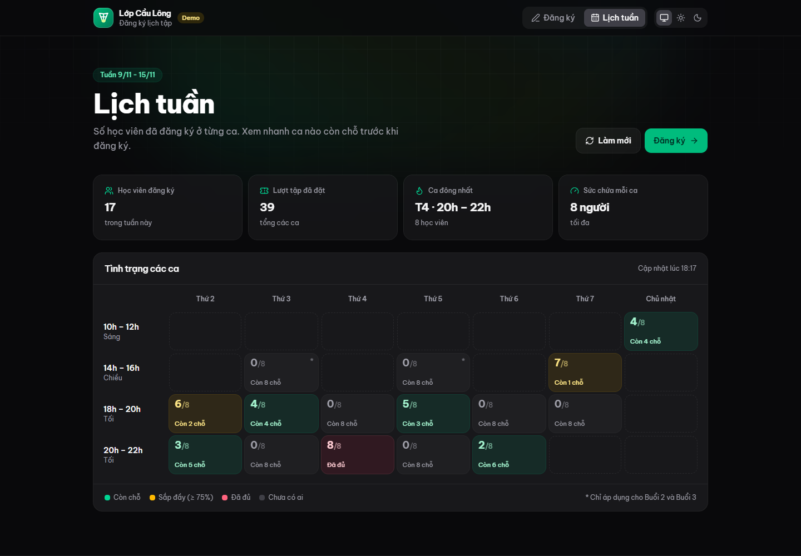
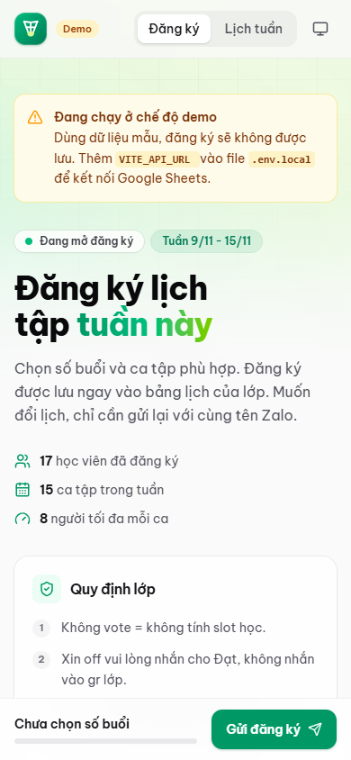

# Badminton Class Booking

A web app for the weekly badminton class sign-up. Students pick their sessions, and can later
look up, change or delete their booking using their phone number or email. Class staff sign in
with email and password to an admin page. The interface is in **Vietnamese and English**. The
data lives in
your own **PostgreSQL** database, and all personal data is **encrypted** (AES-256-GCM). The app
is built around Vietnam's personal data protection law (Law 91/2025/QH15); see
[docs/data-protection.md](docs/data-protection.md).



| Weekly schedule (dark)                                  | Mobile                                         |
| ------------------------------------------------------- | ---------------------------------------------- |
|  |  |

## Architecture

```
Browser ──► Vue 3 app (frontend/) ──/api/v1──► Fastify API (backend/) ──► PostgreSQL
                                                   │
                                                   └─ encrypts name / phone / email / notes
                                                      before they reach the database
```

| Part     | Stack                                                                                  |
| -------- | -------------------------------------------------------------------------------------- |
| Frontend | Vue 3, TypeScript, Vite, Vue Router, Pinia, vue-i18n, Tailwind CSS v4, Vitest          |
| Backend  | Node.js, Fastify 5, TypeScript, Zod validation, Drizzle ORM and migrations, Vitest     |
| Database | **PostgreSQL**, free and open source. In production it runs on **Supabase**; during development it runs embedded through PGlite, with nothing to install. |
| Security | Admin sign-in (scrypt passwords, lockout, httpOnly sessions) with role checks, AES-256-GCM field encryption, HMAC blind indexes, rate limits, Helmet, audit log |

```
frontend/                 Vue app (see frontend/src: components, views, stores, services…)
backend/
  src/
    app.ts                Fastify app: plugins, error handling, routes
    server.ts             Entry point, retention job, graceful shutdown
    config/env.ts         Environment validation (Zod)
    db/                   Schema, connection (PostgreSQL or PGlite), default settings
    lib/                  crypto (AES-GCM, HMAC), contact normalization, errors
    modules/
      auth/               password sign-in, sessions, admin accounts, role guards
      schedule/           GET /schedule
      bookings/           create/update, lookup, delete, retention purge
      admin/              admin API (admin role or ADMIN_TOKEN)
      audit/              processing log
  drizzle/                SQL migrations (applied automatically on start)
  scripts/                keys:generate, admin:create, db:migrate, export:bookings, retention:purge
  test/                   API tests on an in-memory PostgreSQL
docs/data-protection.md   What is encrypted, how it maps to Vietnamese law, key rotation
docker-compose.yml        Optional PostgreSQL + pgAdmin
```

## Getting started

Requires **Node.js 22.18+ or 24.12+**.

```sh
npm install                          # installs frontend + backend (npm workspaces)
npm run keys:generate -w backend     # creates backend/.env with fresh encryption keys
npm run admin:create -w backend -- --email you@example.com --name "Your Name"
npm run dev                          # API on :3000 + web app on http://localhost:5173
```

`admin:create` prints a temporary password once. Sign in at `/dang-nhap` (or the **Quản trị**
link in the footer) and change it under **Đổi mật khẩu**.

`keys:generate` writes the encryption keys and an admin token into `backend/.env`. **Back them up**
in a password manager. Without `ENCRYPTION_KEY`, the stored personal data can't be decrypted.

With no `DATABASE_URL`, the API uses an embedded PostgreSQL stored in `backend/data/pglite`, so
there's nothing to install. The Vite dev server forwards `/api` to the backend.

UI-only work, with no backend: set `VITE_DEMO=true` in `frontend/.env.local`.

### Admin sign-in and roles

| Who | Gets |
| --- | --- |
| Students (no account) | Book, look up, change or delete their own booking |
| **Admin** (`admin`) | Admin page `/quan-tri`: all bookings with contacts, CSV export, deleting bookings, class settings (week, slots, capacity, open/closed), admin accounts (add, reset password, delete) |

Permissions are checked by the API on every request; the Vue route guards only decide what to
show. To protect a new admin-only API route, call `requireRole(request, ['admin'])` (or register
it under `/api/v1/admin`). For a new page, add `meta: { roles: ['admin'] }` to its route. To add
another role later (for example `coach`), extend `ROLES` in `backend/src/db/schema.ts` with a
migration for the CHECK constraint.

### Languages

The UI is in Vietnamese (default) and English. Switch with **EN / VI** in the header; the choice
is remembered in the browser.

- Texts live in `frontend/src/i18n/locales/vi.ts` and `en.ts`. `en.ts` is type-checked against
  `vi.ts`, so a missing key fails `npm run type-check`.
- The API returns error **codes** (and `params`), which the frontend translates
  (`apiErrors.*`).
- Slot labels are still entered in Vietnamese (`Thứ 2 18h - 20h`) and are shown as
  `Monday 18:00 – 20:00` in English.
- Class rules are shown as written.

### Scripts (from the repo root)

| Command                                  | What it does                                      |
| ---------------------------------------- | ------------------------------------------------- |
| `npm run dev`                            | Run backend and frontend together                 |
| `npm run build`                          | Type-check and build both into `dist/` folders    |
| `npm test`                               | Run the backend and frontend test suites          |
| `npm run lint` / `npm run type-check`    | Lint and type-check both                          |
| `npm run db:studio -w backend`           | Open a web UI to browse the database (Drizzle Studio) |
| `npm run export:bookings -w backend`     | Decrypted CSV of this week (`-- --contacts` adds phone/email) |
| `npm run retention:purge -w backend`     | Delete bookings older than `RETENTION_DAYS`       |
| `npm run db:generate -w backend`         | Create a migration after changing `db/schema.ts`  |

## Accessing the database yourself

The data is in tables named `settings`, `bookings` and `audit_logs`. You can browse them in three
ways:

1. **Drizzle Studio**, the quickest: run `npm run db:studio -w backend` and open the link it
   prints. With the embedded database, stop the API first, because only one process can open it
   at a time.
2. **Supabase**, the production database: browse the tables in Supabase's **Table Editor**, or
   connect pgAdmin, DBeaver or `psql` with the session pooler connection string. Setup is in
   [docs/deployment.md](docs/deployment.md#1-create-the-supabase-database).
3. **A local PostgreSQL**: `docker compose --profile local-db up` starts PostgreSQL 17 and pgAdmin
   (http://localhost:5050).

   For Supabase or a local server, set `DATABASE_URL` in `backend/.env` and restart. Migrations
   run automatically.
4. **The admin API** or the **export script**, for decrypted views.

Personal data columns (`name_enc`, `contact_enc`, `makeup_enc`) show as ciphertext such as
`v1.1.xkvm…` in any database tool. That's intended. Class settings in the `settings` table are
plain text, so you can edit the week, slots, capacity and open/closed directly there.

### Each week

Change `week_label` in the `settings` table (for example `16/11 - 22/11`), or use the admin API.
Bookings are grouped by week label, so per-slot counts start again from zero.

## API (`/api/v1`)

| Method & path            | Body                                                         | Purpose                                  |
| ------------------------ | ------------------------------------------------------------ | ---------------------------------------- |
| `GET /schedule`          | –                                                            | Week, rules, slots, per-slot counts, privacy info |
| `POST /bookings`         | `{ zaloName, contact, count, slots, makeup, consent: true }` | Create (201) or update (200) this week's booking |
| `POST /bookings/lookup`  | `{ contact }`                                                | The student's booking (name and sessions, never the contact) |
| `POST /bookings/delete`  | `{ contact }`                                                | Delete the booking and its personal data |
| `GET /health`            | –                                                            | Health check                             |
| `GET /auth/me`           | –                                                            | `{ user }`: `{ id, email, name, role }` or null |
| `POST /auth/login`       | `{ email, password }`                                        | Signs in and sets the session cookie (10 tries / 15 min per IP) |
| `POST /auth/logout`      | –                                                            | Ends the session                         |
| `POST /auth/password`    | `{ currentPassword, newPassword }`                           | Changes your password; signs out your other sessions |

The phone or email always travels in a POST body, never in the URL. Errors return
`{ error: { code, message, params? } }`. `message` is a Vietnamese default; clients translate by
`code`, filling in `params` (for example `{ slot }` for `SLOT_FULL`).

**Admin**, under `/api/v1/admin`. Allowed with an admin session (signed in, role `admin`) or
`Authorization: Bearer <ADMIN_TOKEN>` for scripts. Anonymous requests get 401, other roles 403.

- `GET /bookings?week=&includeContact=true`: decrypted bookings
- `DELETE /bookings/:id`
- `PUT /settings`: change week, rules, slots, capacity or open
- `GET /users`: admin accounts with last sign-in
- `POST /users` with body `{ email, name }`: returns `{ user, temporaryPassword }` (shown once)
- `POST /users/:id/reset-password`: returns `{ temporaryPassword }`, signs that account out
- `DELETE /users/:id`: not yourself, not the last admin
- `GET /audit-logs`: the processing log
- `POST /retention/purge`

Every admin read of personal data is written to the audit log.

## Docker and deployment

The [Dockerfile](Dockerfile) builds **one image** containing both parts: the Fastify API also
serves the built Vue app, with SPA fallback and long-term caching of hashed assets. Configuration
comes only from environment variables.

```sh
docker compose up --build        # http://localhost:3000, using DATABASE_URL from backend/.env
```

**Free hosting:** Supabase (database) and Render (container), both in Singapore, plus a free
domain. The step-by-step guide is in **[docs/deployment.md](docs/deployment.md)**, and
[`render.yaml`](render.yaml) deploys the app with one click as a Render Blueprint.

## Data protection

See **[docs/data-protection.md](docs/data-protection.md)**. It covers what is encrypted, consent,
students' rights (view, edit, delete in `/sua-lich`), automatic deletion, the audit log, key
rotation, and your duties as data controller (breach notification, DPIA, hosting location).
